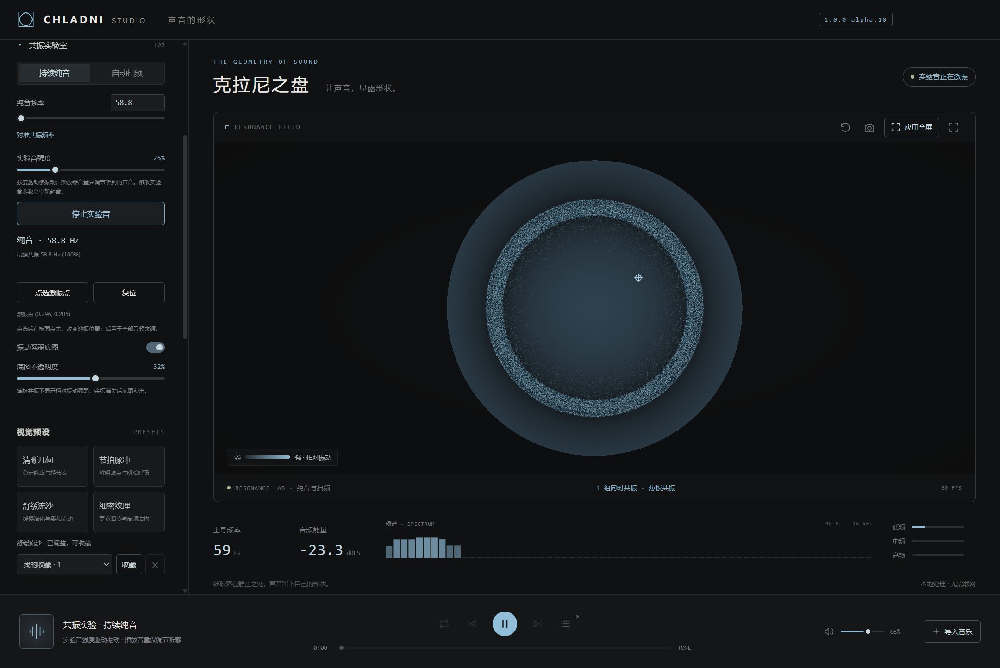
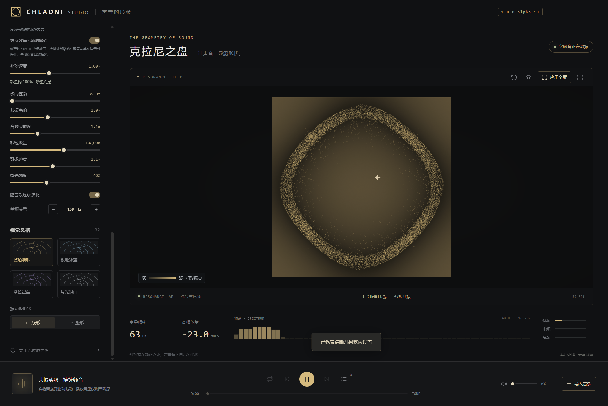
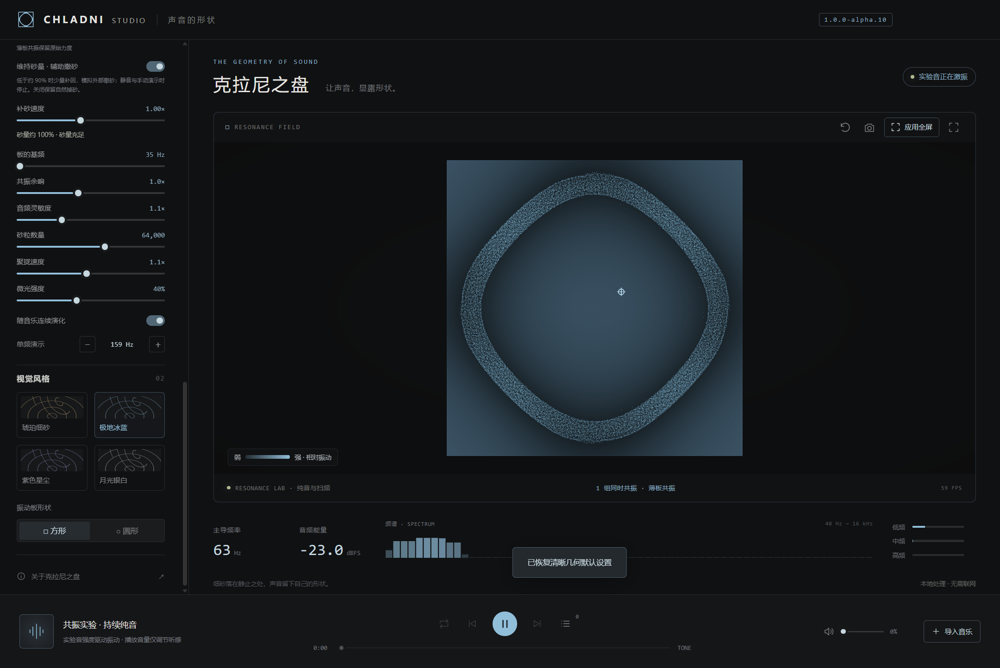
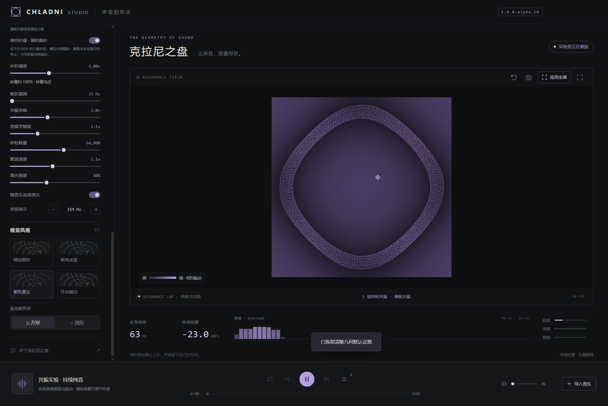
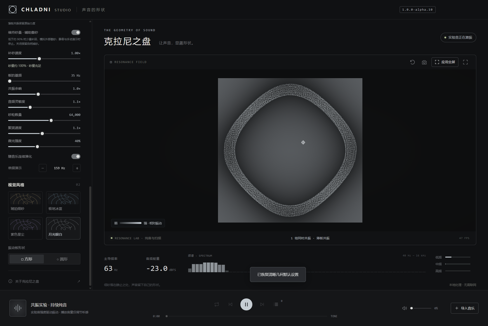

# Chladni Studio · 克拉尼之盘

[](https://github.com/jcz1024/chladni-studio/releases/tag/v1.0.0-alpha.10)
[](https://github.com/jcz1024/chladni-studio/releases/tag/v1.0.0-alpha.10)
[](LICENSE)
[](https://github.com/jcz1024/chladni-studio/actions/workflows/ci.yml)

让声音显露形状。Windows 音乐可视化播放器，以连续多模态共振驱动砂粒，支持电脑系统声音、本地音频文件与纯音/扫频实验。

A Windows music visualizer and local audio player inspired by Chladni plates, built with Electron, Web Audio and WebGL 2.

**[下载 Windows ZIP](https://github.com/jcz1024/chladni-studio/releases/download/v1.0.0-alpha.10/Chladni-Studio-1.0.0-alpha.10-Windows-x64.zip)** · **[Release / 单独下载 EXE](https://github.com/jcz1024/chladni-studio/releases/tag/v1.0.0-alpha.10)** · [版本记录](CHANGELOG.md) · [模型说明](PHYSICS.md)



## 主要功能

- **实时系统音频**：监听 Windows 默认播放设备的声音，音频在本机处理。
- **本地播放器**：多文件导入、拖放、播放列表、暂停、跳转、音量与单曲循环。
- **两种共振调校**：音乐响应突出清晰节线与节拍；薄板共振使用自由边缘方/圆板模态响应。
- **共振实验室**：20–4,000 Hz 纯音、对数扫频、点选激振位置、相对振动底图与模态指示。
- **画面控制**：四套配色、四套预设、自定义收藏、辅助补砂、PNG 导出。
- **两种全屏**：保留全部界面并覆盖任务栏的应用全屏，以及独立沙盘沉浸全屏。

当前版本为 **1.0.0-alpha.10 预览版**，界面以中文为主。薄板使用线性模态，砂粒运动与接触采用近似模型；适合声音可视化和交互探索，不用于预测实际金属板实验结果。

## 运行成品

从上方 Release 下载 Windows ZIP，解压后双击 `Chladni-Studio-1.0.0-alpha.10-Windows-x64.exe`，无需安装 Node.js。首次启动会解压内置运行时，可能需要几秒钟。ZIP 同时包含使用说明、示例音频、验证报告及版本源码；只需程序时也可单独下载 EXE。GitHub 自动生成的 “Source code” 压缩包用于开发，不包含 EXE。

运行要求：Windows 10 / 11，x64；显卡驱动支持 WebGL 2 和浮点颜色纹理。尚未进行代码签名。

Release 中提供 `SHA256SUMS.txt`。可用 PowerShell 的 `Get-FileHash .\Chladni-Studio-1.0.0-alpha.10-Windows-x64.zip -Algorithm SHA256` 核对下载文件。

## alpha.10 配色修复

播放按钮、滑块、开关、边框、文字强调色、底图、图例和激振标记统一随四套配色更新。四张配色预览保持各自颜色。

| 琥珀细砂 | 极地冰蓝 |
| --- | --- |
|  |  |
| **紫色星尘** | **月光银白** |
|  |  |

## 共振实验室

1. 左侧选择 **纯音 / 扫频**，展开“共振实验室”。启动实验音会使用薄板共振并开启连续演化；音频实际经过共振处理器。
2. **持续纯音**：输入 20–4,000 Hz 的频率或拖动滑块，点击“开始纯音”。“对准共振频率”可对准当前最强共振，没有输入时对准手动演示所选模态。
3. **自动扫频**：设置起止频率、单程 5–120 秒时长；可单程停止或往返循环。频率按对数连续变化，数值框/滑块修改提交后会重新起音；不自动播放。
4. **实验音强度**决定进入共振计算的正弦幅度；底部播放器音量仅控制实验音的听音输出。停止实验音或切换来源会释放振荡器，重启应用后保持静音。
5. **点选激振点**：薄板模式下点击按钮，再点击板面。板心附近会吸附到准确中心；Esc 结束点选，“复位”恢复默认近中心点。新点位会同时更新模态耦合与空间振型，后台计算期间保留现有砂粒。方/圆板均可用，适用于所有音频来源。
6. **振动强弱底图**：在薄板模式打开，用不透明度控制强度，暗色较弱、亮色较强，随当前配色变化。显示相对空间分布，余振消失后淡出；不会改变砂粒受力。实验室还显示当前实验频率和最强几组共振。
7. **砂量状态与补砂速度**：显示 GPU 统计的近似砂量、待机或补砂状态，速度可调 0.25–2 倍。点位、底图、补砂速度随画面设置及收藏保存；实验音参数单独保存，不包含在视觉收藏中。

## 保留的薄板体验

- **过密接触**：在板振动时让过密的砂堆舒展，避免节线附近因局部振动小而失去排斥。停音后仍会静止；板的原始共振与力度保持一致。
- **轻微亮度压缩**：只调节薄板模式的极密区域，亮度系数最多降低 15%，稀疏区域保持原亮度。
- **维持砂量 · 辅助撒砂**：薄板模式默认开启，低于约 90% 时缓慢、分散补回，新砂渐入。模拟外部供砂，可关闭以保留自然掉砂；静音和手动演示时停止。与音乐自动补砂分别保存，收藏与重启均保留。

## 预设与收藏

- **自动灵敏度**：音乐响应默认开启，在分析端平衡不同输入音量，播放音量保持用户设置。手动灵敏度仍可微调；薄板共振保持原始力度。
- **自动补砂**：音乐响应默认开启，有实际输入且连续演化开启时，越界砂粒会错峰补回并渐入；静音、手动单频演示时停止。薄板模式另有较慢的辅助撒砂选项。
- **四套预设**：清晰几何、节拍脉冲、舒缓流沙、细密纹理，分别改变主导结构、节奏、演化速度和细节。
- **自定义收藏**：调整参数后点击“收藏”，命名保存；下拉选择恢复，× 删除所选。最多 32 项，应用重启后保留。收藏保存画面与响应参数，不包含歌曲、播放音量或窗口状态；恢复默认画面不会删除收藏。

| 预设 | 特点 | 初始粒数 | 默认外观 |
| --- | --- | ---: | --- |
| 清晰几何 | 3 组主导结构，轮廓清晰 | 64,000 | 方板，琥珀 |
| 节拍脉冲 | 4 组结构，增强节奏与呼吸 | 64,000 | 方板，紫色 |
| 舒缓流沙 | 平缓演化，轻柔节奏 | 48,000 | 圆板，冰蓝 |
| 细密纹理 | 最多 6 组结构，偏重高频细节 | 80,000 | 方板，银白 |

## 使用方法

1. **监听电脑声音**：左侧选择「系统声音」，点击「开始监听系统声音」，然后在浏览器、音乐软件或其他程序中播放音频。监听的是 Windows 默认播放设备。更换耳机或扬声器后，请停止并重新开始监听。
2. **作为音乐播放器**：点击「导入音乐」，支持一次选择多首；也可以将音频文件拖入窗口。导入后自动播放，可暂停、拖动进度、调整音量、切歌、单曲循环和管理当前播放列表。
3. **试听效果**：选择「共振演示」，点击「试听共振音」。内置音频为本地合成的节奏与和声；也可导入下载包 `示例音频/多模态节奏示例.wav`。自动模式无音频时砂粒静止；手动单频演示使用模拟激励。
4. **共振方式**：默认「音乐响应」，突出主导节线，用沿线流动与微光呼吸表达节奏；「薄板共振」保留更窄的物理共振选择性，使用多频平均振动加速度。基频改变共振的整体尺度，余响改变振动衰减。完整砂纹形成需要砂粒运动时间；两种调校的近似边界见 PHYSICS.md。
5. **调节画面**：切换四套配色、方形／圆形振动板、砂粒数量、聚拢速度、灵敏度和微光。手动单频演示会关闭「随音乐连续演化」；重新勾选即可恢复。
6. **验证单频砂纹**：恢复默认设置、选择「薄板共振」，基频保持 35 Hz。导入示例音频中的方板 63.07 Hz 或圆板 58.81 Hz WAV，并选择对应板形。停音后余振衰减，砂粒会静止；砂粒越过板边会落下，按 R 补砂。
7. 画面右上方可重新撒砂、保存 PNG、切换全屏。「应用全屏」按钮（Ctrl + F11）让整个应用覆盖任务栏，保留标题栏、侧栏、频谱和播放器。沙盘图标按钮（F11 / 双击画面）进入独立的沙盘沉浸全屏。Esc 或右上方「退出全屏」返回原窗口。切换到其他程序时会释放临时置顶。视觉设置与播放器音量自动保存在本机；播放列表仅在当前会话有效。

支持 MP3、WAV、FLAC、OGG、Opus、M4A、AAC、WebM。可播放性取决于具体编码与容器，损坏文件或不支持的编码会给出提示。音频始终在本机处理。

| 快捷键 | 操作 |
| --- | --- |
| 空格 | 播放／暂停，系统模式下开始／停止监听 |
| Ctrl + O | 导入音乐 |
| R | 重新撒砂 |
| F11 / 双击画面 | 沙盘沉浸全屏 |
| Ctrl + F11 | 整个应用全屏，覆盖任务栏并保留全部界面 |
| Esc | 退出全屏 |

## 开发与构建

环境：Node.js 24、npm、Windows x64。依赖版本由 `package-lock.json` 固定。

```powershell
git clone https://github.com/jcz1024/chladni-studio.git
cd chladni-studio
npm ci
node node_modules/electron/install.js
npm run assets
npm start
```

```powershell
npm test
npm run pack
npm run dist
```

`npm test` 运行无需桌面和音频设备的 21 项基础检查。GitHub Actions 在 Windows 上运行基础检查及解包构建；真实系统声音、GPU 和全屏验证需在本机交互桌面运行：

```powershell
npm run test:desktop
node scripts/realtime-smoke.cjs
node scripts/grain-regression.cjs
node scripts/physical-quality.cjs
node scripts/lab-smoke.cjs
node scripts/palette-smoke.cjs
node scripts/music-visual-check.cjs
node scripts/experience-smoke.cjs
node scripts/fullscreen-smoke.cjs
```

`npm run dist` 输出便携 exe 到 `release/`。本项目固定的 Electron 45 需要在 `npm ci` 后显式运行上述安装脚本，下载运行时；只安装 npm 包不足以启动或打包。构建和测试缓存可通过环境变量 `electron_config_cache`、`ELECTRON_BUILDER_CACHE` 指定到可写目录；打包采用项目内已安装的 Electron 运行时。CI 使用 `npm run pack -- --publish never`，只验证构建，不自动发布成品。

`npm run test:desktop` 会短暂播放测试音，自动验证 GPU 聚拢、真实 FFT、文件播放／暂停／跳转／音量／循环／切歌、Windows 系统声音回环、全屏、错误恢复与图片保存。测试截图和 JSON 报告写入 `output/`。

专项脚本可能需要本地 Windows 桌面、默认音频输出设备或已构建的 EXE。`scripts/package-release.cjs --palette-patch` 与验证汇总脚本面向原始发布工作目录，部分需要历史 alpha.9 下载包及已有报告；克隆仓库后的独立 EXE 构建使用 `npm run dist` 即可。仓库里的历史实测说明见 [VALIDATION.md](VALIDATION.md)，报告快照见 [docs/validation](docs/validation)。

## 代码结构

- `electron/`：桌面窗口、系统声音授权、文件访问令牌、流式媒体与原生对话框。
- `src/physics.js`：自由边缘方板/圆板模态、点激振耦合与共振积分系数。
- `src/plate-worker.js`：后台重建点选激振位置的振型纹理。
- `src/experiment.js`：实验音参数校验与对数扫频时序。
- `src/plate-data.js`：24 阶自由方板 Ritz 系数，可用 scripts/generate-free-square.cjs 重建。
- `src/resonator-worklet.js`：音频采样率下的连续受迫共振、能量与瞬态提取。
- `src/engine.js`：GPU 共振场合成、砂粒惯性／密度压力／起落与渲染。
- `src/audio.js`：Web Audio 连接、FFT 仪表、系统回环流、合成共振音。
- `src/app.js`：播放器、来源切换、设置、播放列表与交互。
- `RESEARCH.md`：GitHub 项目比较、官方技术参考与取舍。

效果采用线性薄板模态响应与近似砂粒动力学。音乐响应的相干包络节线含视觉化处理；薄板共振也不是完整的有限元和逐粒接触求解。它不用于预测真实金属板实验结果。详细边界见 PHYSICS.md，实测数据见 VALIDATION.md。

## 参与和许可

欢迎通过 [Issue](https://github.com/jcz1024/chladni-studio/issues/new/choose) 反馈问题和建议，或提交 Pull Request。开发约定见 [贡献指南](CONTRIBUTING.md)，安全问题见 [安全说明](SECURITY.md)。

项目采用 [MIT License](LICENSE)。第三方运行时与素材说明见 [THIRD_PARTY_NOTICES.md](THIRD_PARTY_NOTICES.md)；原始调研记录见 [RESEARCH.md](RESEARCH.md)。
